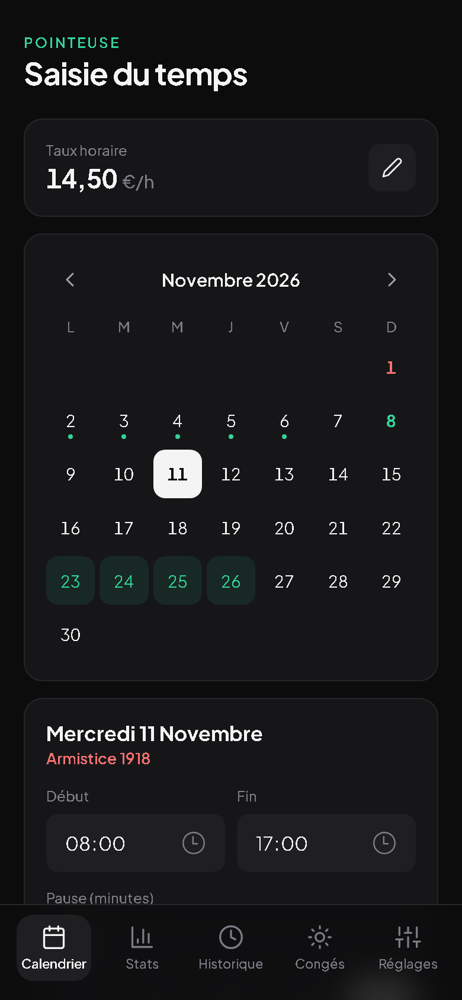
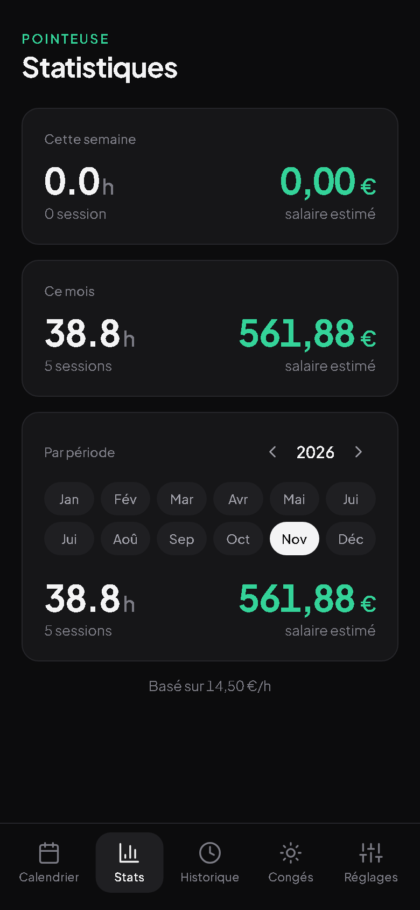
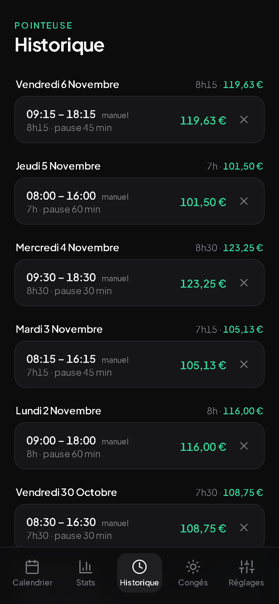
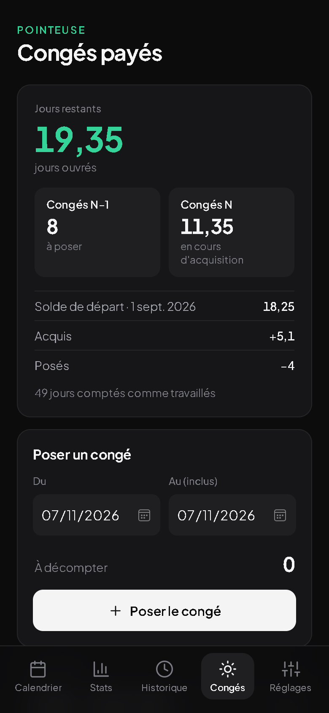
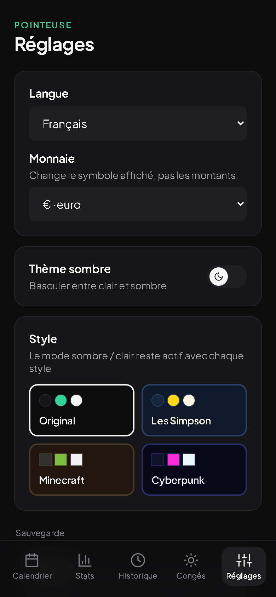
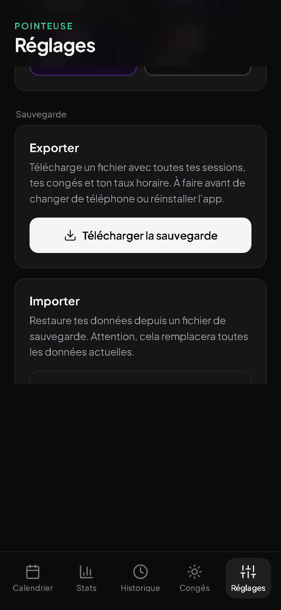
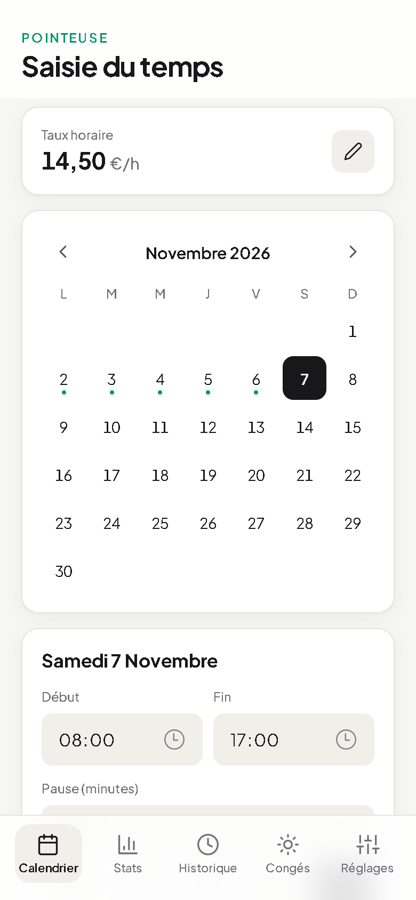
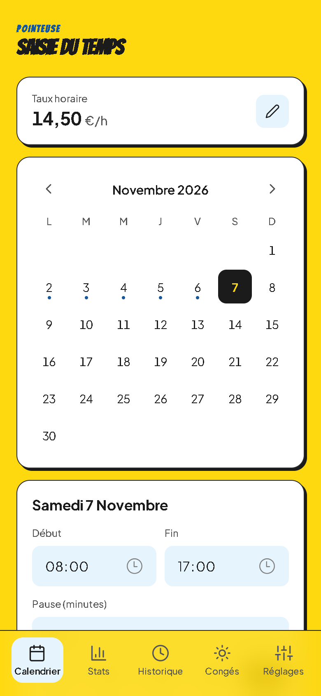
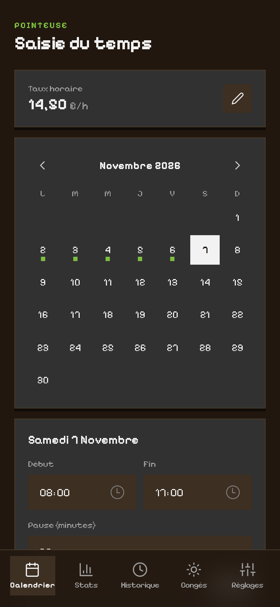
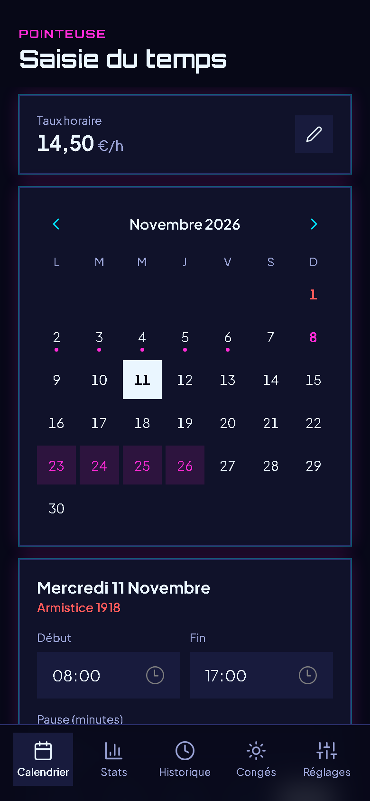

# ⏱️ WorkTracker — Pointeuse PWA

**WorkTracker** est une application web progressive (PWA) de suivi du temps de travail, pensée pour une utilisation mobile rapide et sans friction. Enregistre tes heures, calcule ton salaire automatiquement, gère tes congés payés et garde un historique complet de tes journées, directement depuis ton téléphone. Disponible en 9 langues et 8 monnaies. Tes données restent sur ton téléphone.

🔗 **Accéder à l'app** : [https://worktracker-two.vercel.app](https://worktracker-two.vercel.app)

---

## 👀 Aperçu de l'app

<table>
  <tr>
    <td align="center"> <b>Calendrier</b></td>
    <td align="center"> <b>Statistiques</b></td>
    <td align="center"> <b>Historique</b></td>
  </tr>
  <tr>
    <td align="center"> <b>Congés payés</b></td>
    <td align="center"> <b>Réglages</b></td>
    <td align="center"> <b>Sauvegarde</b></td>
  </tr>
</table>

*Captures réalisées avec des données d'exemple.*

## 🎨 4 styles au choix, en clair ou en sombre

<table>
  <tr>
    <td align="center"> <b>Original</b></td>
    <td align="center"> <b>Les Simpson</b></td>
    <td align="center"> <b>Minecraft</b></td>
    <td align="center"> <b>Cyberpunk</b></td>
  </tr>
</table>

---

## 📱 Les 5 onglets

| Onglet | Description |
|---|---|
| 📆 **Calendrier** | Saisie manuelle des heures de travail (arrivée, départ, pause). |
| 📊 **Stats** | Statistiques de la semaine en cours (lundi → dimanche), du mois en cours et de n'importe quel mois au choix, avec calcul automatique du salaire estimé selon le taux horaire. |
| 📋 **Historique** | Liste chronologique de toutes les sessions enregistrées, avec durée et temps de pause pour chaque journée. |
| ☀️ **Congés** | Soldes N-1 et N calculés d'après les jours saisis (droit français), pose de congés et soldes de départ à recopier depuis la fiche de paie. |
| ⚙️ **Réglages** | Langue, monnaie, thème clair / sombre, style (Original, Simpson, Minecraft, Cyberpunk) et, tout en bas, sauvegarde : export et import des données au format JSON. |

---

## ✨ Fonctionnalités principales

- 📝 **Saisie manuelle des heures** avec gestion des pauses (en minutes)
- 🌍 **9 langues** : français, anglais, allemand, espagnol, portugais, italien, néerlandais, polonais, turc
- 💱 **8 monnaies** : € $ £ ₺ CHF zł R$ CA$ (le symbole change, pas les montants)
- 📊 **Statistiques** par semaine, par mois ou pour un mois au choix
- 🌙 **Horaires de nuit** gérés (ex. 22h → 6h, la fin est comptée le lendemain)
- 💰 **Calcul automatique du salaire** selon ton taux horaire
- ☀️ **Congés payés** : soldes N-1 et N estimés en jours ouvrables ou ouvrés, congés affichés sur le calendrier
- 🤒 **Arrêts maladie et absences** : l'arrêt maladie fait acquérir 2 jours par mois (24 max), l'accident du travail, la maternité ou la paternité comptent comme du travail
- 📅 **Jours fériés** de métropole, d'Alsace-Moselle et d'outre-mer
- 💾 **Sauvegarde et restauration** des données via export/import de fichier JSON
- 🌗 **Thème clair / sombre** et 4 styles au choix
- ⏱️ **Écran de démarrage** animé avec le logo de l'app, aux couleurs du style choisi

---

## 📲 Installation sur mobile

### 🍏 iPhone (Safari)

1. Ouvre [https://worktracker-two.vercel.app](https://worktracker-two.vercel.app) dans **Safari**
2. Appuie sur l'icône **Partage** (le carré avec une flèche vers le haut) 🔗
3. Sélectionne **Sur l'écran d'accueil** ➕
4. Confirme en appuyant sur **Ajouter**

L'application apparaît alors comme une app native sur ton écran d'accueil. 🎉

### 🤖 Android (Chrome)

1. Ouvre [https://worktracker-two.vercel.app](https://worktracker-two.vercel.app) dans **Chrome**
2. Appuie sur le menu **⋮** (les 3 points en haut à droite)
3. Sélectionne **Ajouter à l'écran d'accueil**
4. Confirme l'ajout

L'application s'installe comme une app classique, avec son icône dédiée. 🎉

💾 Pense à exporter régulièrement tes données (tout en bas de l'onglet **Réglages**) : elles sont perdues si tu désinstalles l'app.
